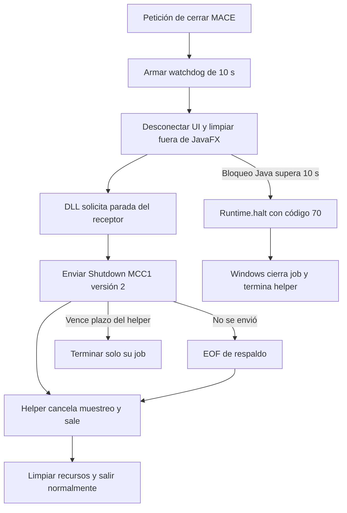

# Fase 2 — Paso 1B: cierre dúplex y salida de último recurso

Pruebas: **16/11/2026, America/Lima**. Rama **LHM_implementado**.

## Alcance y commits

Se parte de **fc615ed507e487922ee2b8dffd40e0996e7648ce**, Paso 1A aprobado.
El informe inicial está en el commit **bcc7f1c9615084a4ff2d29a8e13874f6165f3b64**.
Este documento pertenece al commit independiente
**feat: Fase 2 Paso 1B duplex shutdown and exit watchdog**; el hash definitivo
se entrega en el chat y puede consultarse con git log.

El usuario autorizó el control dúplex con EOF de respaldo, versión documentada,
rechazo de controles inválidos/duplicados y un plazo de último recurso de unos
10 s para evitar un MACE oculto que permanezca vivo por un bloqueo Java.

**Resultado:** protocolo privado 2, un único tipo de control Shutdown, EOF
independiente, preservación de la contención en job y watchdog de proceso.
No se adelantan seguridad de producción, instancia única, estados nuevos,
presupuesto de reinicios ni recuperación de PawnIO en caliente.

## Protocolo y compatibilidad

La especificación completa está en [PROTOCOL.md](PROTOCOL.md). Se incrementan
a 2 las versiones privadas LHM1 (muestras), MCB1 (bootstrap) y MCC1 (control).
Se mantienen tamaños y offsets de las muestras; el bootstrap sigue midiendo
128 bytes. La aplicación helper pasa a 1.1.0.

El servidor de la DLL y el cliente .NET usan dúplex. Se conservan ACL de
usuario/SYSTEM, primera instancia exclusiva, rechazo de remotos, nombre
aleatorio por stdin, lista de handles y verificación de PID en ambos extremos.
El PID del control se contrasta con el padre autenticado por el bootstrap y
el PID del servidor obtenido mediante Windows.

El único control mide 32 bytes: magic MCC1, versión 2, cabecera/tamaño 32,
tipo 1, secuencia 1, PID de MACE y reservado cero. Solo puede aceptarse una vez
por conexión. Versiones, tamaños, tipo, PID, secuencia o reservado incorrectos
se rechazan. No se ejecutan órdenes arbitrarias, no se añade ACK ni ping.

El lector de control funciona independientemente del sondeo de sensores.
Un mensaje parcial vence a los 500 ms desde su primer byte. Después de aceptar
Shutdown se solicita cancelación y se drenan hasta 100 ms para detectar un
duplicado ya encolado. El proceso no espera EOF para salir por control. Un
segundo mensaje posterior a la desaparición del proceso no puede aceptarse
porque la conexión ya no existe.

**EOF sigue solicitando el cierre aun sin recibir ningún control.** La DLL
mantiene el canal abierto durante la salida por control. Si no pudo enviarlo,
cierra el pipe para usar EOF. Se conservan los 2000 ms cooperativos y hasta
1000 ms adicionales de confirmación tras terminar el job; la escritura del
control comparte el plazo cooperativo y no hace FlushFileBuffers bloqueante.
Los límites de kernel/cuarentena descritos en 1A siguen siendo aplicables.

| DLL / helper | Compatibilidad |
|---|---|
| 2 / 2 | Pareja vigente: control dúplex y EOF de respaldo |
| 2 / 1 o 1 / 2 | Incompatibles; bootstrap/versión se rechazan, sin downgrade ni muestras aceptadas como válidas |
| 1 / 1 | Pareja histórica; no incorpora este control |

Build-Helper/Verify-Artifacts y el manifiesto de runtime exigen protocolo 2.
El staging y su verificador comprueban también la marca compilada
MACE_LHM_PROTOCOL=2 de la DLL. Deben reconstruirse y distribuirse juntos; no se
reemplaza solo uno en una imagen antigua. Esta comprobación evita mezclas
accidentales: **no autentica al publicador**. La raíz de confianza, firma,
anulaciones de desarrollo y manifiesto seguro de dependencias son del Paso 2.

El ABI público no cambia: **1.4**, tamaños CPU V2 56 B, GPU V2 104 B,
inventario 296 B y TelemetryData 28 B; IDs y campos reserved conservados.

## Temporizador de último recurso en Java

ShutdownCoordinator arma una sola vez un hilo daemon independiente con un
deadline de **10 s medidos con System.nanoTime()**. Se arma desde el primer
intento de cierre, antes de desconectar vistas, ocultar la ventana o esperar a
monitoreo, persistencia y telemetría. Los cierres repetidos no extienden el plazo.
La limpieza sigue en su hilo no daemon y fuera de JavaFX.

Si el proceso aún existe al vencer el plazo, el watchdog llama
**Runtime.getRuntime().halt(70)**. No escribe ni hace flush de logs antes de
halt: un stream bloqueado tampoco debe anular el último recurso. El watchdog
permanece armado incluso si terminaron los recursos, para cubrir una salida
JavaFX pendiente, un callback o hooks bloqueados. Al salir normalmente el
proceso, su hilo daemon desaparece sin retener la JVM.

Se usa halt porque System.exit puede quedarse esperando hooks que no terminen.
La semántica está documentada por
[Oracle, Runtime y terminación de JVM](https://docs.oracle.com/en/java/javase/22/docs/api/java.base/java/lang/Runtime.html#halt(int)).
**Halt no ejecuta finally, cierres pendientes ni hooks: pueden perderse datos
de persistencia todavía no confirmados.** Es un recurso excepcional autorizado,
no el camino normal de salida. Windows cierra los handles del proceso y el
job de 1A termina el helper propio y sus descendientes.

El plazo depende de que Windows/JVM puedan planificar el watchdog. No garantiza
tiempo real ante averías de kernel, suspensión o falta extrema de recursos.
La inyección de presupuesto/acción de salida solo tiene acceso de paquete para
las pruebas; el producto usa el constructor de 10 s, sin opción de entorno.

## Secuencia



## Estados y resultados

| Caso | Resultado |
|---|---|
| Shutdown válido | Cancelación del helper, salida 0; no requiere EOF |
| EOF sin Shutdown | Cancelación del helper y salida 0 |
| Control inválido, duplicado o parcial vencido | Rechazo y salida 1; no continúa en un bucle colgado |
| Versión privada antigua recibida por DLL nueva | READ_FAILED/0 en la prueba de receptor; no se acepta como una lectura válida |
| CP_ShutdownTelemetry ya solicitado | Los sondeos siguen devolviendo MACE_E_NOT_INITIALIZED, como en 1A |
| Java/monitoreo/persistencia/hooks no terminan | Watchdog termina la JVM con código 70; el job termina su helper |
| Cierre Java normal | Código 0 en la JVM desechable; no se utiliza el watchdog |

Los controles se prueban por resultado de proceso y las métricas conservan su
contrato previo. No se agregan estados de UI ni se reutilizan reservados. La
explicación detallada de causas a la UI continúa pendiente del Paso 4.

## Resultados de validación

| Batería | Base 1A | Resultado de 1B |
|---|---|---|
| Helper automático | 63 | **86 aprobadas**, incluidas las 63 existentes y 23 comprobaciones nuevas de control |
| CTest | 46 | **49 aprobadas**, sin fallos |
| Java | 281 aprobadas + 1 omitida | **286 aprobadas + 1 omitida**, sin fallos/errores |
| Helper publicado real | No estaba esta batería | **5 casos de control aprobados** |
| Payload | 6 comprobaciones | **8 aprobadas**, con rechazo de DLL/helper privados 1 |
| Integridad protegida | Aprobada | NVML, IGCL, DXGI, uso CPU, FILETIME, RAM, IDs y layouts intactos |

La omisión Java sigue siendo la DLL antigua opcional MACE_LEGACY_DLL. Las tres
pruebas de JVM del watchdog sí se ejecutaron, no se omitieron. Las pruebas de
hardware existentes usan la DLL nueva y helper publicado; no amplían la matriz
de plataformas físicamente verificadas.

### Casos nuevos y distinción de evidencia

- ControlTests valida el golden de 32 bytes compartido con C, campos incorrectos,
  longitud, secuencia duplicada, EOF, fragmentación incompleta y canales dúplex
  reales de Windows. Son pruebas del protocolo, no lecturas físicas certificadas.
- lhm_job_control-close demuestra salida por control manteniendo abierto el pipe;
  la DLL rechaza un segundo envío. lhm_job_eof-close demuestra EOF sin control.
  Ambos comprueban salida 0 del helper simulado, sin confundirla con terminación forzada.
- lhm_old-version y los tests wire rechazan muestras privadas 1 y futuras no
  admitidas. Se conserva el resto de CTest de validez, seguridad y cierre.
- Contra el **ejecutable publicado real**, bootstrap privado, PID y primeras
  muestras WARMING_UP: control válido 737 ms/salida 0, EOF 632 ms/salida 0,
  inválido 631 ms/salida 1, duplicado 631 ms/salida 1 y parcial 735 ms/salida 1
  en la última ejecución. El pipe se mantuvo abierto en los casos de control.
  Son tiempos locales, no límites universales ni prueba de exactitud de sensores.
- Dos pruebas Java con latches comprueban el watchdog cuando se bloquean recursos
  o el callback final. Su acción de salida se inyecta para no matar la JVM de JUnit.
- Tres **JVM desechables reales** usan el watchdog de producción de 10 s y la
  DLL nativa con helper simulado poseído: limpieza bloqueada -> 70, hook bloqueado
  -> 70, cierre normal -> 0. Se espera también la desaparición del helper por su
  ProcessHandle exacto, sin búsquedas destructivas por nombre/PID. No representan
  una prueba visual del launcher elevado completo.

El helper se recompiló y publicó en un directorio nuevo, con 205 archivos
verificados. Firma omitida con aviso. Se validaron secuencialmente la publicación,
sus controles reales, Java y el payload; la DLL no se recompiló mientras Java
verificaba/consumía su hash. PawnIO se copió como archivo intacto para staging,
sin ejecutar su instalador ni cambiar HVCI.

### Hashes de la compilación comprobada

| Archivo | SHA-256 |
|---|---|
| mace_native.dll | 768959981F6C10AA2F044202D77137DFBA0C039287A6F141D4094744D6D5DE86 |
| Mace.Lhm.Helper.exe | 4BD9669A1B09D1B99B50777476CEDC1DEF54E986217F2DAB76FF6036A07AFB71 |
| Mace.Lhm.Helper.dll | 73847367500DFA0CC6FAACC8472B309BC6275FB6655BE7BF355BCA6FDF35FE25 |
| Mace.Lhm.Protocol.dll | DE05B41F8C920C5F249CBC0C45B1658D8E03024A09211A4AA91E133F6C707F21 |

El EXE es un apphost: su hash aislado no demuestra la integridad de todas las
DLL de comportamiento/dependencias. Se conserva el manifiesto completo de la
publicación y la comprobación de todos sus archivos; fijar su confianza es Paso 2.

## Cambios por archivo

Rutas relativas al repositorio.

| Archivo | Cambio |
|---|---|
| helper/Mace.Lhm.Protocol/ControlProtocol.cs | Encoder, validación estricta, único cierre y lector con deadlines/EOF/drenaje de duplicados |
| helper/Mace.Lhm.Protocol/WireProtocol.cs | Versión privada 2; layouts y significado de métricas conservados |
| helper/Mace.Lhm.Protocol/Bootstrap.cs | Exigir versión 2 en el bootstrap |
| helper/Mace.Lhm.Protocol/PrivatePipe.cs | Servidor de referencia dúplex con las mismas protecciones |
| helper/Mace.Lhm.Helper/Program.cs | Cliente dúplex, lector independiente, cancelación antes de volver a sondear, salida por control/EOF y errores sin rutas |
| helper/Mace.Lhm.Helper/Mace.Lhm.Helper.csproj | Versión de aplicación 1.1.0 |
| helper/Mace.Lhm.Tests/Program.cs | Adaptar versión de fixtures y ejecutar nuevas comprobaciones/CLI de procesos |
| helper/Mace.Lhm.Tests/ControlTests.cs | 23 comprobaciones de control sin certificación de hardware |
| helper/Mace.Lhm.Tests/ControlProcessTests.cs | Cinco casos contra helper publicado con bootstrap/PID reales |
| helper/Build-Helper.ps1 | Publicar manifiesto privado 2 |
| helper/Verify-Artifacts.ps1 | Rechazar artefactos de protocolo 1 |
| helper/PROTOCOL.md | Especificación vigente y matriz de compatibilidad |
| helper/README.md | Documentación operativa del helper vigente |
| native/src/telemetry/lhm_wire.h | Versión/identificador privado y tamaño de control |
| native/src/telemetry/lhm_wire.c | Decoder exige versión 2 |
| native/src/telemetry/lhm_transport.h | Estado privado de autenticación/secuencia y envío interno de cierre |
| native/src/telemetry/lhm_transport.c | Servidor dúplex, bootstrap 2, envío único y EOF de respaldo dentro del plazo |
| native/tests/lhm_fake_helper.c | Cliente dúplex, consumo de Shutdown y escenario de versión antigua |
| native/tests/test_lhm_wire.c | Fixture versión 2 y rechazo de versiones 1/futuras |
| native/tests/test_lhm_receiver.c | Esperar READ_FAILED para versión antigua |
| native/tests/test_lhm_job.c | Cierre por control sin EOF, EOF sin control y salida de proceso 0 |
| native/CMakeLists.txt | Tres casos CTest nuevos, sin instalarlos |
| app/src/main/java/com/mace/presentation/ShutdownCoordinator.java | Watchdog único de 10 s, halt(70) y acción inyectable solo para pruebas |
| app/src/main/java/com/mace/presentation/MaceApplication.java | Armar antes de cualquier limpieza/ocultación y constructor de prueba |
| app/src/test/java/com/mace/presentation/MaceApplicationStopTest.java | Evitar que un test unitario arme halt real en JUnit |
| app/src/test/java/com/mace/presentation/ShutdownCoordinatorTest.java | Dos casos adicionales de bloqueo Java |
| app/src/test/java/com/mace/presentation/ShutdownWatchdogProbe.java | Harness de JVM desechable, nunca empaquetado |
| app/src/test/java/com/mace/presentation/ShutdownWatchdogProcessTest.java | Tres procesos reales y desaparición de sus helpers |
| packaging/stage-runtime.ps1 | Exigir declaración privada 2 en DLL/helper y emitir runtime-manifest compatible |
| packaging/verify-runtime.ps1 | Comprobar perfil privado y declaración de DLL |
| packaging/tests/test-runtime-payload.ps1 | Dos rechazos adicionales de componentes antiguos |
| packaging/README.md | Distribución conjunta y pruebas actualizadas |
| helper/FASE2-PASO1B.md | Este informe |

La auditoría de referencias retiradas se regenera para conservar líneas/columnas
actuales; no se anonimiza ni modifica evidencia histórica de terceros.

## Comandos de reproducción

Desde la raíz, en PowerShell con .NET fijado, MSVC/Windows SDK, JDK 22 y Maven:

```powershell
powershell -NoProfile -ExecutionPolicy Bypass -File .\helper\Build-Helper.ps1
powershell -NoProfile -ExecutionPolicy Bypass -File .\native\scripts\test-lhm1b.ps1 -BuildDirectory .\native\build\fase2-1b\compiled
$helperDirectory=(Get-Content .\helper\artifacts\latest.txt -Raw).Trim()
$env:MACE_LHM_HELPER=Join-Path $helperDirectory 'Mace.Lhm.Helper.exe'
& .\helper\Mace.Lhm.Tests\bin\Release\net10.0-windows\win-x64\Mace.Lhm.Tests.exe --control-process-tests $env:MACE_LHM_HELPER
# Ajustar JAVA_HOME a un JDK 22 instalado.
$env:JAVA_HOME='C:\Program Files\Java\jdk-22'
$env:MACE_NATIVE_LIB=(Resolve-Path .\native\build\fase2-1b\compiled\Release\mace_native.dll).Path
$env:MACE_NATIVE_SHA256=(Get-FileHash -LiteralPath $env:MACE_NATIVE_LIB -Algorithm SHA256).Hash
$env:MACE_LHM_HELPER_SHA256=(Get-FileHash -LiteralPath $env:MACE_LHM_HELPER -Algorithm SHA256).Hash
$env:MACE_WATCHDOG_FAKE_HELPER=(Resolve-Path .\native\build\fase2-1b\compiled\Release\lhm_fake_helper.exe).Path
mvn.cmd -o -f .\app\pom.xml test
powershell -NoProfile -ExecutionPolicy Bypass -File .\native\scripts\check-protected-telemetry.ps1
powershell -NoProfile -ExecutionPolicy Bypass -File .\native\scripts\audit-retired-providers.ps1
```

Las pruebas de watchdog crean JVM desechables; no ejecutar ShutdownWatchdogProbe
dentro de una JVM que tenga otro trabajo que conservar. No se requiere elevar
para estos casos de protocolo/ciclo de vida. El modo Maven offline necesita las
dependencias ya descargadas.

Payload, usando el instalador intacto ya disponible como archivo, sin ejecutarlo:

```powershell
$pawnInstaller=(Resolve-Path .\packaging\dist\MACE\app\prerequisites\PawnIO_setup.exe).Path
powershell -NoProfile -ExecutionPolicy Bypass -File .\packaging\tests\test-runtime-payload.ps1 -NativeDll $env:MACE_NATIVE_LIB -HelperDirectory $helperDirectory -PawnIoInstaller $pawnInstaller -JavaExe "$env:JAVA_HOME\bin\java.exe"
```

Los logs están ignorados bajo native/build/fase2-1b: helper.log, native.log,
real-control.log, java.log y payload.log; CTest XML bajo compiled/ y XML Java
en app/target/surefire-reports. Los frameworks pueden incluir perfiles/rutas
locales en esos archivos; no se distribuyen. Los nuevos diagnósticos de control
usan etiquetas, códigos y tiempos, sin copiar rutas personales, hostname ni PID.

## NO VERIFICADO y riesgos pendientes

- Cierre visual del launcher MACE.exe elevado y bloqueo real de su persistencia
  en disco: NO VERIFICADO. Sí se probaron JVM reales con bloqueos deliberados,
  incluyendo un hook, y helpers simulados dentro del job real.
- Pérdida y recuperación de datos de persistencia si se fuerza halt: NO VERIFICADO;
  los datos no confirmados pueden perderse y no se garantiza limpieza por finally.
- Suspensión/reanudación, falta extrema de recursos y averías de kernel: NO VERIFICADO.
- Coexistencia con LHM del usuario, CPU Intel, NVIDIA principal/respaldo, Intel
  GPU/IGCL, PawnIO en equipo limpio y HVCI actual: NO VERIFICADO físicamente.
- Instalación MSI/EXE y código real 3010: NO VERIFICADO. No se ejecutó PawnIO.
- packaging/dist/MACE conserva la app-image histórica de 1D. Se verificó staging
  del conjunto nuevo, no se regeneró una app-image ni se adelantó el Paso 2.
- La versión privada impide mezclas accidentales; no cierra aún TOCTOU, permisos
  de instalación, sustitución de dependencias ni autenticidad del publicador.
- Firma de código, licencia y revisión legal de redistribución siguen pendientes.

No se modificaron NVML, IGCL, GetSystemTimes/ReadCpuUsagePercent, DXGI, RAM, los
headers de layout ni los launchers/manifiesto UAC. No se instaló/desinstaló PawnIO,
no se cambió HVCI y no se fusionó a principal. No hay una decisión nueva pendiente
para terminar este paso; las decisiones ya aprobadas de pasos posteriores se conservan.

**Paso 1B terminado. Se detiene el trabajo hasta aprobación del usuario antes del Paso 2.**
