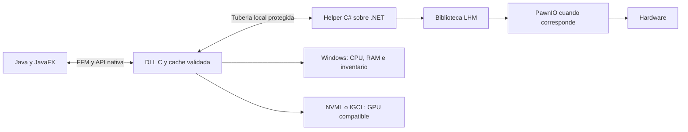

# Informe: migración a LHM, PawnIO, .NET, firmas y licencias en MACE

Fecha: **18 de noviembre de 2026**. Referencia de fuentes locales: `cd96559`.
Documento explicativo basado en código, configuración e informes del proyecto
y documentación oficial. No modifica el producto ni autoriza instalaciones.
El análisis de licencias es informativo; no constituye asesoría legal.

## 1. Qué cambió en el proyecto

MACE conserva su aplicación **Java/JavaFX** y su biblioteca nativa **C**. El
cambio consiste en utilizar **LibreHardwareMonitor (LHM)** como biblioteca de
lectura para determinados sensores, mediante un proceso auxiliar escrito en
**C#**, llamado `Mace.Lhm.Helper.exe`. Ese proceso utiliza **.NET** y, para
ciertos accesos de bajo nivel, el controlador **PawnIO**.

Se integra la biblioteca `LibreHardwareMonitorLib`, no la aplicación de
escritorio de LHM. El usuario no necesita abrir un monitor externo para que
MACE obtenga sus muestras. El helper forma parte del conjunto distribuido.

| Componente | Responsabilidad en MACE |
|---|---|
| Java/JavaFX | Interfaz, presentación de métricas, mensajes y lógica de aplicación |
| `mace_native.dll`, en C | API nativa, fuentes Windows, proveedores gráficos, recepción y validación de muestras |
| Helper C# | Ejecutar LHM, recoger sensores y transmitir muestras a la DLL |
| Biblioteca LHM | Detectar dispositivos y obtener/interpretar lecturas disponibles |
| Runtime .NET | Ejecutar el código C# y las bibliotecas administradas del helper |
| PawnIO | Acceso al hardware desde un controlador del kernel cuando el backend lo necesita |

LHM es un proyecto de monitorización que ofrece sensores de temperatura,
ventiladores, carga y otras magnitudes según el dispositivo. Su disponibilidad
general no garantiza que cada sensor exista en todos los equipos.
[Fuente: proyecto oficial LHM](https://github.com/LibreHardwareMonitor/LibreHardwareMonitor).

## 2. Por qué se pasó a LHM

La implementación anterior tenía lectores de CPU e integraciones específicas
por fabricante que MACE debía mantener directamente. La migración consolidó
parte de esas lecturas alrededor de LHM y retiró implementaciones anteriores,
conservando identificadores públicos reservados para no romper compatibilidad.
El detalle de esa limpieza está en [RESULTADOS-1D-PASO1.md](RESULTADOS-1D-PASO1.md).

La decisión reduce la cantidad de lógica de acceso e interpretación de
sensores que se mantiene dentro de MACE y permite aprovechar el trabajo de
una biblioteca especializada. A cambio, introduce dependencias externas,
un proceso adicional y la obligación de verificar qué lecturas son realmente
utilizables. No elimina el mantenimiento: lo reparte entre MACE y sus componentes.

La migración es **selectiva**:

| Información | Fuente conservada o incorporada |
|---|---|
| Uso de CPU | Windows mediante `GetSystemTimes()` |
| RAM | API de Windows |
| Inventario de GPU | Windows/DXGI |
| Sensores CPU, especialmente temperatura y potencia | Helper LHM, con sus condiciones de disponibilidad |
| GPU NVIDIA | NVML continúa como proveedor primario |
| GPU Intel compatible | IGCL continúa como proveedor primario |
| Sensores GPU AMD previstos por el proyecto | LHM, sujeto a identidad y validez por métrica |

Por tanto, pasar a LHM no convierte toda la telemetría en dependiente de un
único lector. Si falla el helper, las fuentes independientes pueden seguir
aportando datos. Referencias: [README nativo](../native/README.md),
[README del helper](README.md) y [contrato ABI](../native/docs/ABI.md).

## 3. Cómo se comunican Java, C y el helper

La DLL inicia el helper y recibe muestras aproximadamente a **1 Hz** mediante
una tubería local protegida. Se comprueban los procesos de ambos extremos y
la integridad del conjunto. El helper comunica tanto números como su estado,
el estado de PawnIO y si está elevado. La DLL decide qué puede marcar como válido.

La interfaz consulta la caché; no espera a que el helper termine una lectura.
Una muestra antigua o incoherente deja de ser válida y se presenta como N/D.
Un número finito por sí solo no demuestra que el sensor esté funcionando.
Tampoco se declara inválido cualquier cero: por ejemplo, un ventilador puede
estar legítimamente a 0 RPM. Estas reglas están en
[RESULTADOS-1B.md](RESULTADOS-1B.md) y [PROTOCOL.md](PROTOCOL.md).

El proceso separado permite gestionar reinicios del helper, cierre acotado y
fallos de comunicación sin cargar el runtime .NET dentro de la JVM. El Job
Object contiene el helper propio; no se trata de controlar instancias ajenas
de LHM. Esta separación ayuda a contener fallos, pero no garantiza aislamiento
frente a un administrador ni elimina los riesgos de un controlador compartido.

## 4. Qué es PawnIO y por qué se necesita

En este informe, «Pawn» se refiere a **PawnIO**. Pawn es también el nombre del
lenguaje que utiliza su sistema de módulos; no es el lenguaje de la interfaz
de MACE.

Windows no expone todas las temperaturas y contadores de energía como datos
ordinarios disponibles para cualquier aplicación. Algunas lecturas requieren
acceso privilegiado al hardware. PawnIO ofrece ese puente mediante un
controlador del kernel y módulos de acceso. Su distribución oficial está
firmada por su publicador. [Fuente: sitio oficial PawnIO](https://pawnio.eu/).

En la versión LHM utilizada, el lector Intel emplea un módulo PawnIO para sus
accesos. Esto se puede contrastar en el
[código Intel de LHM 0.9.6](https://raw.githubusercontent.com/LibreHardwareMonitor/LibreHardwareMonitor/v0.9.6/LibreHardwareMonitorLib/Hardware/Cpu/IntelCpu.cs).
PawnIO habilita el acceso; LHM interpreta la información y MACE la valida y
presenta. Instalar un driver no garantiza que un modelo concreto exponga todos
los sensores solicitados.

En MACE se distinguen situaciones que requieren explicaciones diferentes:

- Sin elevación: temperatura/potencia CPU pueden quedar no disponibles.
- PawnIO ausente: no equivale a estar detenido.
- PawnIO detenido: no significa que Windows necesite reiniciarse.
- Retorno real 3010 de instalación: indica reinicio pendiente, cuyo consumo
  por MACE sigue siendo trabajo de Fase 3.
- Helper no disponible o no verificable: es un problema distinto del driver.

El estado de servicio se consulta mediante Windows; no se inventa un reinicio
pendiente a partir de un fallo de sensores. La aplicación conserva las demás
métricas disponibles y explica la limitación con su estado correspondiente.

PawnIO se considera **compartido**: otra aplicación puede utilizarlo. La política
aprobada prevé conservarlo al desinstalar MACE y respetar versiones distintas
sin actualización automática. La versión inicial admitida en el diseño es
**2.2.0.0**. Copiar su instalador intacto dentro de la app-image **no lo instala**.
La instalación automática aún no está implementada ni validada como release.
Véanse [diseño](FASE3-DISENO.md) y [adenda vigente](FASE3-DISENO-ADENDA.md).

## 5. Cómo influye .NET en MACE

**.NET es la plataforma de ejecución del helper C# y de LHM.** No sustituye a
Java ni obliga a reescribir la interfaz. Java se comunica con C mediante FFM;
C se comunica con el proceso .NET mediante la tubería.

La configuración actual, comprobable en
[Directory.Build.props](Directory.Build.props), [global.json](global.json) y
[el proyecto del helper](Mace.Lhm.Helper/Mace.Lhm.Helper.csproj), fija:

- SDK de compilación **10.0.401**.
- Runtime **10.0.12**, destino `net10.0-windows`, arquitectura `win-x64`.
- Helper **1.1.1** y biblioteca LHM **0.9.6**.
- Publicación **autocontenida**: se distribuye el runtime necesario junto al helper.

El **SDK** sirve para compilar y publicar; lo necesita el desarrollador. El
**runtime** ejecuta el resultado; lo necesita el programa. Al incluirlo en la
publicación autocontenida, el usuario no tiene que instalar por separado .NET
para este helper. Microsoft documenta esta diferencia entre publicación
autocontenida y dependiente del runtime del sistema.
[Fuente: publicación .NET](https://learn.microsoft.com/en-us/dotnet/core/deploying/).

Esto tiene consecuencias prácticas:

| Área | Consecuencia |
|---|---|
| Instalación | La ejecución del helper no depende de encontrar un .NET global compatible |
| Tamaño | El paquete incorpora runtime y dependencias; el conjunto del helper tiene 202 archivos de ejecución, no todos pertenecen exclusivamente a .NET |
| Ejecución | Hay otro proceso con su memoria y actividad; su costo exacto debe medirse, no se ha cuantificado en este informe |
| Actualizaciones | MACE debe mantener y redistribuir su runtime incluido; actualizar el .NET global del equipo no sustituye automáticamente esa copia |
| Integridad | Cambiar una DLL o el runtime puede invalidar el manifiesto y su hash compilado; una actualización exige reconstruir y verificar el conjunto |
| Licencias | Distribuir el runtime y sus dependencias también requiere conservar sus licencias y avisos |

El compromiso es una dependencia de ejecución más previsible para el usuario,
a cambio de mayor tamaño y responsabilidad de mantenimiento para el proyecto.

## 6. Por qué son importantes las firmas digitales

Una firma de código permite comprobar **quién firma un archivo** y si su
contenido se modificó después. Su confianza depende del certificado, la cadena
de confianza y la verificación correspondiente. No certifica que el programa
carezca de errores ni sustituye pruebas o revisión de seguridad.
[Fuente: Microsoft, firma de código](https://learn.microsoft.com/en-us/windows/win32/seccrypto/cryptography-tools).

En MACE importa especialmente porque el producto empaquetado solicita
administrador y utiliza un componente que accede al hardware. Entregar un
ejecutable sustituido tendría más consecuencias que mostrar una lectura errónea.
La firma aporta una identidad verificable al binario que recibe el usuario.

Un **hash SHA-256** y una **firma** tienen funciones relacionadas, pero distintas:

| Mecanismo | Qué permite comprobar | Límite |
|---|---|---|
| Hash y manifiesto | Que los bytes coinciden con el valor esperado | Si un atacante sustituye archivo y manifiesto no confiado, la mera coincidencia no identifica al publicador |
| Pin compilado en otro componente confiado | Que el componente coincide con el conjunto aprobado | Sigue dependiendo de cómo se confía en el componente que guarda el pin |
| Firma de código verificada | Integridad del archivo e identidad del firmante según el certificado | No concede permiso de redistribución ni demuestra compatibilidad del hardware |

Para aplicaciones de usuario, **no es una condición universal para compilar
o ejecutar cualquier programa**. Los builds de prueba de MACE pueden seguir
sin firma propia con advertencia, como se aprobó. Para una distribución pública
fiable, la firma es una medida importante de autenticidad. No garantiza que
desaparezcan todos los avisos de Windows: SmartScreen también evalúa reputación
del archivo y otros indicadores.
[Fuente: Microsoft Defender SmartScreen](https://learn.microsoft.com/en-us/windows/security/operating-system-security/virus-and-threat-protection/microsoft-defender-smartscreen/).

Los **controladores del kernel** tienen requisitos de firma específicos de
Windows, distintos de firmar una aplicación ordinaria. MACE conserva la firma
original del instalador/driver de PawnIO; no lo modifica ni lo vuelve a firmar.
Firmar MACE no reemplaza los requisitos del controlador ni demuestra que HVCI
lo acepte en todos los equipos.
[Fuente: política de firma de drivers de Microsoft](https://learn.microsoft.com/en-us/windows-hardware/drivers/install/kernel-mode-code-signing-policy--windows-vista-and-later-).

El orden de construcción también importa: firmar modifica bytes. El diseño
prevé firmar los archivos propios del helper antes de generar su manifiesto,
compilar la DLL con ese hash, firmar la DLL y fijar los pins del paquete; después
se verifica y firma el conjunto de distribución según el diseño aprobado.
Refirmar el helper al final rompería la correspondencia ya fijada.
La selección de certificado/servicio de MACE sigue **pendiente**.

## 7. Por qué son necesarias las licencias

La licencia establece los permisos y condiciones para **usar, copiar, modificar
y redistribuir** software. Que un programa sea gratuito o tenga código visible
no significa que se pueda distribuir de cualquier manera. El código propio
de MACE y cada dependencia conservan sus derechos y condiciones.

También hace falta decidir la licencia **de MACE** para que otras personas
sepan cómo pueden contribuir y reutilizarlo. Publicar un repositorio en GitHub
no equivale por sí solo a conceder una licencia libre general.
[Fuente: GitHub, licencias de repositorios](https://docs.github.com/en/repositories/managing-your-repositorys-settings-and-features/customizing-your-repository/licensing-a-repository).

| Elemento | Situación y efecto para el proyecto |
|---|---|
| LHM 0.9.6 | MPL-2.0: conservar avisos y cumplir disponibilidad de fuentes de los archivos cubiertos, incluidas modificaciones aplicables |
| Runtime .NET 10.0.12 | Licencia principal MIT, con avisos de sus componentes; conservar los textos distribuidos |
| PawnIO y sus módulos | Revisar licencia, excepción y fuentes del conjunto exacto; no basta que el instalador esté firmado o se copie intacto |
| Java/JavaFX y otras dependencias | Revisar los artefactos reales; el runtime Oracle actualmente empaquetado no se reclasifica como GPL por llamarse Java |
| Mono.Posix.NETStandard 1.0.0 | Licencia y correspondencia exacta de fuentes **NO VERIFICADAS**: bloqueo explícito de revisión legal de distribución |
| Código propio MACE | Licencia **pendiente de elección por el usuario**; este informe no aplica ninguna |

La [licencia LHM del tag 0.9.6](https://raw.githubusercontent.com/LibreHardwareMonitor/LibreHardwareMonitor/v0.9.6/LICENSE)
y la [FAQ oficial MPL](https://www.mozilla.org/en-US/MPL/2.0/FAQ/)
explican sus obligaciones por archivo; usar una biblioteca MPL no obliga por
mera agregación a elegir esa misma licencia para todos los archivos propios.
La [licencia del runtime .NET 10.0.12](https://raw.githubusercontent.com/dotnet/runtime/v10.0.12/LICENSE.TXT)
declara MIT; ello no elimina los avisos de terceros incluidos en el runtime.

El [README oficial de PawnIO](https://github.com/namazso/PawnIO)
declara GPL versión 2 o posterior con una excepción para determinadas formas
de comunicación. Distingue el acceso por IOCTL de módulos cargados mediante
la interfaz Pawn. **No se concluye por ello que cualquier combinación sea
compatible**, ni que separar procesos elimine obligaciones. Debe comprobarse
la licencia del driver, módulos e instalador exactos que se distribuyan.

Estas licencias libres normalmente no requieren comprar una licencia por cada
instalación: requieren **cumplir sus condiciones**. Un certificado de firma
puede tener costo, pero comprarlo no concede derechos sobre código ajeno.
Las herramientas de construcción también pueden tener condiciones propias;
el análisis específico de WiX sigue en la [adenda de diseño](FASE3-DISENO-ADENDA.md).

## 8. Estado del proyecto y condiciones antes de distribuir

La integración LHM/helper/.NET existe y tiene regresión documentada en
[FASE2-CIERRE.md](FASE2-CIERRE.md). Este informe no repite esas pruebas ni
amplía su cobertura. El cambio conserva DLL 1.5.0, ABI 1.5, protocolo 2 y helper
1.1.1; una futura actualización debe comprobar compatibilidad e integridad.

El usuario informa de equipos Intel, uno con gráficos integrados y otro con
NVIDIA. Eso orienta las pruebas de CPU/IGCL/NVML, pero no demuestra que todos
sus sensores ni HVCI estén verificados con el conjunto actual. Instalación
limpia, 3010 real y las verificaciones físicas pendientes mantienen el estado
**NO VERIFICADO** donde así lo indican los informes.

Antes de una distribución pública quedan, entre otros: resolver la licencia
propia y los bloqueos de terceros, mantener el runtime elegido, definir la
estrategia de firma, aprobar e implementar el instalador y validar el paquete
en la VM y hardware acordados. La presencia de avisos de terceros es parte de
ese trabajo, no una aprobación legal completa.

La integración técnica, la autenticidad del binario y los permisos de
redistribución deben revisarse por separado: **LHM/PawnIO/.NET hacen posible
la lectura; hashes y firmas sostienen la confianza del conjunto; las licencias
determinan bajo qué condiciones puede compartirse**.
